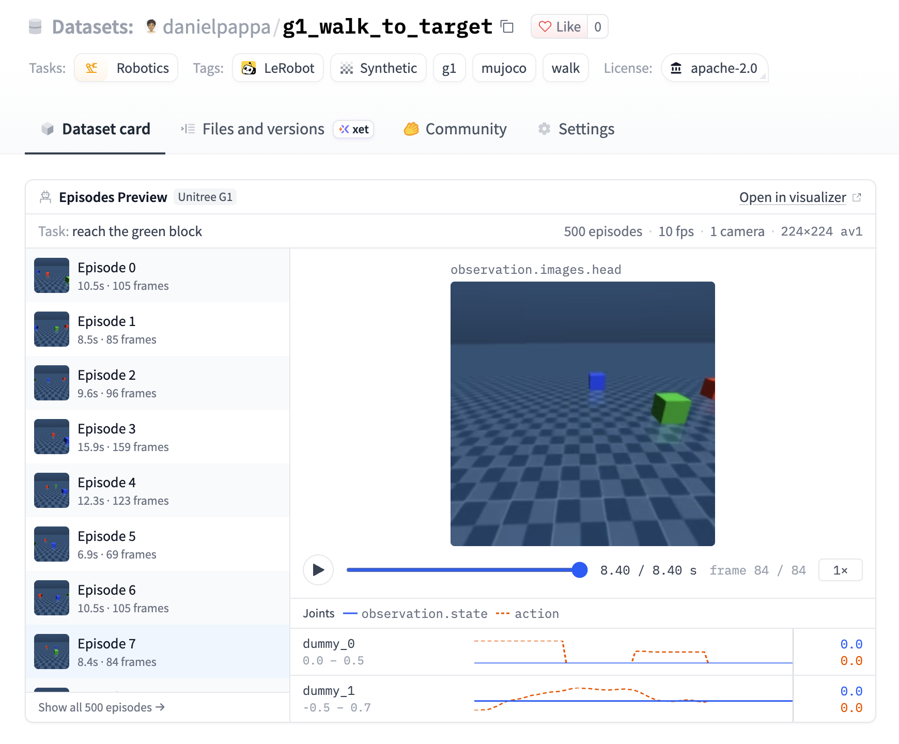

# LeRobot

[LeRobot](https://huggingface.co/docs/lerobot/index) is Hugging Face's library for teaching robots by example. Guide a robot through a task a few times and it learns to do it on its own, from 3D-printed arms to full humanoids.

It is based on the concept of imitation learning, i.e. robots learn from demonstrations, with the following four steps applying on every robot:
1. **Teleoperate**: Move the robot with a leader arm, phone, gamepad or VR device.
2. **Record**: Each run is saved as a dataset (video plus movements)
3. **Train**: A model is trained to control the robot on this data.
4. **Deploy**: The model is run on the robot.

LeRobot offers the entire robot learning end to end workflow, providing standardized dataset formats, which can be uploaded to Hugging Face and loaded directly into code, as well as Spaces for tests and demos, and AI models which can be trained with some relatively straightforward commands. Additionally it provides, benchmarks, compute, policies (e.g. RL trained ones), and simulation environments.

#### Command Cheat Sheet

Will be filled in as the project goes on and additional commands are used.
For detailed information check out the official repo at [LeRobot](https://github.com/huggingface/lerobot)

---
**Training**: 
Depending on your hardware training the policy might take a few hours. That’s how you train simple ACT policy:

```bash
lerobot-train \
    --dataset.repo_id=${HF_USER}/so101_dataset_test_YYYYMMDD_HHMMSS \
    --dataset-streaming=True \
    --policy.type=act \
    --output_dir=outputs/train/act_so101_test \
    --job_name=act_so101_test \
    --policy.device=cuda \
    --trackio.enable=true \
    --policy.repo_id=${HF_USER}/policy_test \
    --steps=20000
```
---

#### LeRobot Datasets

`LeRobotDataset` is a standardized format for robot learning data. It provides unified access to multi-modal time-series data, sensorimotor signals and multi‑camera video, as well as rich metadata for indexing, search, and visualization on the Hugging Face Hub. An example is shown below.



A core principle is decoupling storage from the user API: data is stored efficiently (few large files), while the public API exposes intuitive episode-level access.

1. **Tabular data:** Low‑dimensional, high‑frequency signals (states, actions, timestamps) stored in Apache Parquet. Access is memory‑mapped or streamed via the datasets stack.
2. **Visual data:** Camera frames concatenated and encoded into MP4. Frames from the same episode are grouped; videos are sharded per camera for practical sizes.
3. **Metadata:** JSON/Parquet records describing schema (feature names, dtypes, shapes), frame rates, normalization stats, and episode segmentation (start/end offsets into shared Parquet/MP4 files).

> To scale to millions of episodes, tabular rows and video frames from multiple episodes are concatenated into larger files. Episode‑specific views are reconstructed via metadata, not file boundaries

LeRobotDataset returns Python dictionaries of PyTorch tensors and integrates with `torch.utils.data.DataLoader`.

```python
import torch
from lerobot.datasets import LeRobotDataset

repo_id = "lerobot/pusht"

dataset = LeRobotDataset(repo_id, episodes=[0])

sample = dataset[100]
print(sample)
# {
#   'observation.state': tensor([...]),
#   'action': tensor([...]),
#   'observation.image': tensor([C, H, W]),
#   'timestamp': tensor(1.234),
#   ...
# }

delta_timestamps = {
    "observation.image": [-0.2, -0.1, 0.0]  # 0.2s and 0.1s before current frame
}

dataset = LeRobotDataset(repo_id, episodes=[0], delta_timestamps=delta_timestamps)

sample = dataset[100]
print(sample["observation.image"].shape)  # [T, C, H, W], where T=3

batch_size = 16
data_loader = torch.utils.data.DataLoader(dataset, batch_size=batch_size)

device = "cuda" if torch.cuda.is_available() else "cpu"
for batch in data_loader:
    observations = batch["observation.state"].to(device)
    actions = batch["action"].to(device)
    images = batch["observation.image"].to(device)
    # model.forward(batch)
```
> TODO: Check out image transform effect on training


#### Imitation Learning Basics

To be filled in once actually done on real hardware


#### [Unitree G1 Specific Workflow](http://huggingface.co/docs/lerobot/unitree_g1)

Both 23 and 29 DoF variations of the Unitree G1 robot are supported for teleoperation, traininig of locomanipulation policies, tests in simulation, and more.

| Capability | G1-29 | G1-23 |
| :--- | :--- | :--- |
| Joint configuration and action/observation features | 29 body joints, 14 arm joints | 23 body joints, 10 arm joints |
| DDS command/feedback layout | 29 active slots | 29 slots with absent joints left inactive |
| MuJoCo simulation | Supported | Not yet supported; native model planned |
| Locomotion controllers | GR00T and Holosoma | GR00T and Holosoma |
| SONIC whole-body controller | Supported | Not supported; the policy requires 29 DoF |
| Gravity compensation | Supported, off by default | Not yet supported; native kinematics planned |

The remaining parts (setup, teleoperation, locomotion etc. will follow duely)