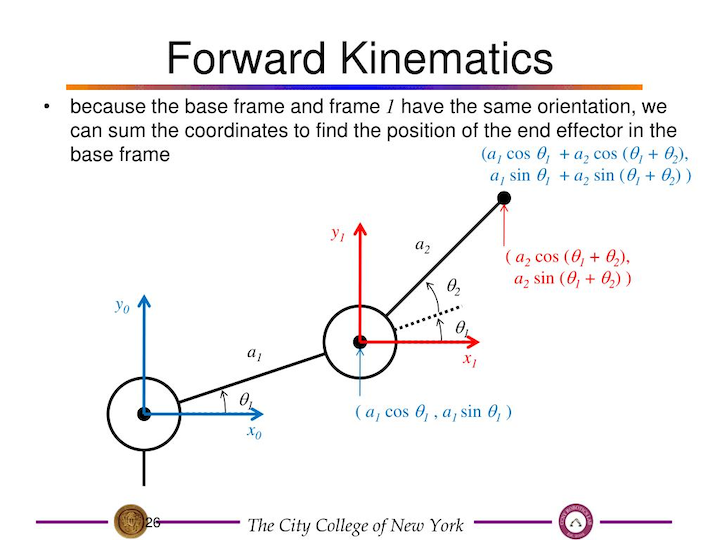
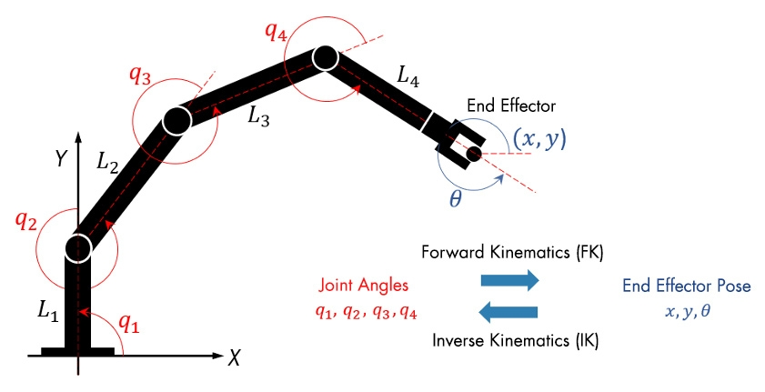

# Robotics

## Control Theory

|Definition|Explanation|
|:--|:--|
|Control Theory|A mathematical framework to command actuators to have their actual and desired state match|
|PID Control|$u(t) = K_p e(t) + K_i \int_0^\tau e(\tau)d\tau + K_d \frac{de(t)}{dt}$  • **Proportional ($K_p$):** reacts to current error • **Integral ($K_i$):** eliminates accumulated error • **Derivative ($K_d$):** dampens oscillation, smoothing the rate of error change|
|Low-Level Control|1000+ Hz; Torque loops running directly on the motor drivers|
|Mid-Level Control|100-500 Hz; For whole body control and balance|
|High-Level Control|1-100 Hz; Task planning, behavior trees and VLAs|

#### Kinematics

Kinematics in this section implies the field studying robot motion, ignoring the underlying forces (dynamics).
The position of a robot is specified using the **configuration space** $\R^n$, where n equals the number of joints of the robot. Joints may have limits in their configuration, in terms of which values in the configuration space they can take.
On the other hand, the **task space** identifies the space in which the task can be naturally expressed, e.g. **end-effector coordinates** such as in 3D, $x = [X, Y, Z, roll, pitch, yaw]$.

1. Forward Kinematics

Defined as the computation of the position of the **end-effector given the joints**. Forward kinematics specifies a mapping from C-Space to task space. The result is a sequence of rigid transformations alternating joint and link from base to the end-effector: $T = Z_1 X_1 Z_2 X_2 ... Z_n X_n$

2. Inverse Kinematics

Inverse Kinematics is a **mapping from task space to c-space**: Given a desired 3D position for the G1's hand, e.g. to grasp an apple, what exact angle must all the joints be set to??
IK is nototriously difficult because of its non-linearity (sin, cos) and because it can have *multiple solutions* (some of which might not even be valid, e.g. elbow up/down), especially on humanoid robots which are *redundant* by definition (have many more degrees of freedom than the task space dimensions).

Analytical Solutions to inverse kinematics exist if and only if $C-Space = Task Space$. Heuristics and iterative optimizations using the Jacobian (1st order derivatives mapping joint velocities to end-effector velocities) e.g. via Newton-Raphson exist for more complex cases.

$$Given (x_2, y_2) -> look\; for\; \theta_1, \theta_2:$$
$$r^2 = a_1^2 + a_2^2 - 2a_1 a_2 \cos \phi$$
$$\phi = 180 - \theta_2 \;\;|\;\; r^2 = x^2 + y^2$$
$$\cos(\theta_2) = \frac{x_2^2 + y_2^2 - a_1^2 - a_2^2}{2a_1 a_2}$$
$$\theta_2 = \pm \arccos(\cos(\theta_2))$$
$$\theta_1 = atan2(y_2, x_2) - atan2(a_2 \sin(\theta_2), a_1 + a_2 \cos(\theta_2))$$

#### Relevant Concepts

- **Degrees of Freedom**:

The number of *independent parameters* (usually joint angles) that define the complete configuration of a robot. E.g. a G1 has 6 floating-base DoF (3D, i.e. x, y, z coordinates and 3 orientations, i.e. roll, pitch and yaw) plus its internal joint DoFs (6 per leg, 1 waist and 5 per arm). Each joint's degree of freedom can be controlled through motors/actuators.

- **Whole Body Control (WBC)**:

An advanced control framework simultaneously coordinating all joints of a robot to achieve tasks (e.g. lean hip, extend arm, ...). WBC solves an optimization problem 1000+ times per second. 

- **Center of Mass (CoM)**:

CoM defines the single point in space where the total mass of the robot is concentrated. Gravity pulls straight down on it, so for G1 to stay upright, the vertical projection of its CoM must be inside its support polygon (feet area).

- **Zero Moment Point (ZMP)**:

The ZMP is an extension of the CoM and defines the point on the ground where the net horizontal inertia and gravity produce zero tipping moment. It is the ultimate metric for dynamic stability during walking (where the CoM may temporarily lean outside the feet, e.g.).

## Hardware Platforms

#### Historical Overview

|Phase|Decades|Summary|
|:--|:--|:--|
|1st Generation|1960s - 1990s|Rigid position control, unsafe around humans; with no force sensing capabilities at the joint level|
|2nd Generation|2000s - 2010s|Pioneered by Boston Dynamics and MIT. Transition from stiff position control to torque control, allowing for impact absorption, running and jumping (elastic and dynamic)|
|3rd Generation|2020s - Present|Shift to low-cost, high torque density actuators with onboard AI compute nodes, providing hardware to execute actions from deep neural networks|

#### Actuators

- **Quasi-Direct Drive Motors** with a low gear ratio (10:1 - planetary gears: prioritize speed over power) paired with brushless motors (replaced brushes with magnets for increased durability). Transparent means obstacle hits dont break, but **back-drive**, a concept which is crucial for safety implementation.
- **Harmonic Drives** with a higher gear ratio (100:1 - prioritize power over speed) provide immense torque in a compact volume with zero backlash and are great for use e.g. in robotic fingers for higher dexterity.

#### Proprioceptive Sensing (internal)

- Absolute and incremental encoders to measure joint angles and rotational velocity directly on the motor.
- IMU to measure linear acceleration and angular velocity to track the whole body.
- Current/torque sensing to enable control.

#### Exteroceptive Sensing (external)

- RGB-D/Depth Cameras providing spatial point clouds used by the VLA
- 3D-Lidar to produce real time point clouds for navigation and mapping
- Tactile/Force arrays measured by piezoresistive or capacitive skin on fingertips, which measure pressure through change in electrical resistance or capatitance respectively.

#### Compute and Protocols

The low-level MCU handles sensor polling and 1000 Hz motor torque loops, whereas the high-level AI-Board runs spatial perception, path planning and VLA inference.
Real-time communication happens with Ethercat, CAN and/or DDS on buses within strict microsecond windows.
- **CAN Bus** at local joint/limb level for actuators and sensors at low level
- **Ethercat** in the main torso e.g. of the G1 tying computer to IMU and actuators
- **DDS** as the middleware connecting software for communication