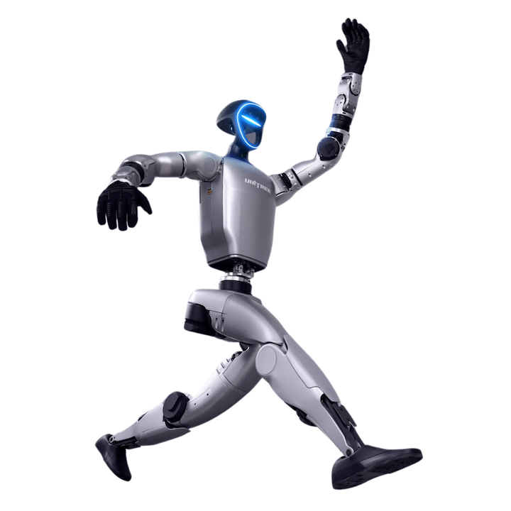

# Unitree Ecosystem

Unitree Robotics is focusing on the R&D, production, and sales of consumer and industry-class high-performance general-purpose legged and humanoid robots, six-axis manipulators, and so on. Their GitHub organization comprises a wide range of thorough repositories for using their robots as well as many concepts on top, such as their own VLA models (UnifoLM-VLA), MuJoCo environments and so on. This page is supposed to provide a brief overview into the ecosystem and will hopefully help to distinguish the different use cases for the many repositories.

|Category|Repository Name|Description|Example Use Case|Link|
|:--|:--|:--|:--|:--|
|Artificial General Intelligence|UnifoLM-WLA|Comprehensive next-generation general-purpose humanoid robot foundation model with 6B parameters.|Benchmark as their latest VLA model|https://github.com/unitreerobotics/unifolm-wla|
|Artificial General Intelligence|UnifoLM-World-Model-Action|Architecture for general purpose robot learning|Used as future world state predictor in WLA|https://github.com/unitreerobotics/unifolm-world-model-action|
|Artificial General Intelligence|UnifoLM-VLA|Older Unitree model mapping vision and language to actions|Used partly as action predictor in WLA|https://github.com/unitreerobotics/unifolm-wla|
|Locomotion|unitree_rl_gym|Official Isaac Gym (outdated) RL training and sim-to-real locomotion framework for Unitree robots|Train or adapt the lower-body RL locomotion/balance controller for G1|https://github.com/unitreerobotics/unitree_rl_gym|
|Locomotion|unitree_rl_lab|Modular Isaac Lab-based RL framework for Unitree locomotion and whole-body tasks|Train lower-body RL policy robust to upper-body arm disturbances|https://github.com/unitreerobotics/unitree_rl_lab|
|Locomotion|unitree_rl_mjlab|MuJoCo RL training repository for Unitree robots|Fast lightweight RL prototyping and lower-body policy training in MuJoCo|https://github.com/unitreerobotics/unitree_rl_mjlab|
|Locomotion|unitree_mujoco|Official MuJoCo simulation environment with SDK2 DDS communication bridge|Test combined $\pi_{0.5}$ upper-body VLA + lower-body RL controller safely in sim|https://github.com/unitreerobotics/unitree_mujoco|
|Manipulation|unitree_lerobot|[LeRobot](./LeRobot.md) integration for recording, converting, and training policies on Unitree datasets|Format G1 teleop data into LeRobot schema for $\pi_{0.5}$ co-fine-tuning|https://github.com/unitreerobotics/unitree_lerobot|
|Manipulation|xr_teleoperate|Apple Vision Pro / Meta Quest XR teleoperation stack for Unitree G1|Collect upper-body bimanual manipulation demonstrations for $\pi_{0.5}$ training|https://github.com/unitreerobotics/xr_teleoperate|
|Manipulation|unitree_robotskills|Collection of modular pre-built skills and task execution routines for Unitree robots|Reference task primitives or baseline upper-body skill execution|https://github.com/unitreerobotics/unitree_robotskills|
|Robot SDK|unitree_sdk2|C++ low-level DDS communication SDK for motor commands and sensor states|Real-time low-level joint command/state interface on G1 hardware and sim|https://github.com/unitreerobotics/unitree_sdk2|
|Robot SDK|unitree_sdk2_python|Python bindings for Unitree SDK2 DDS interface|Bridge Python $\pi_{0.5}$ inference outputs and RL policy actions to G1 joints|https://github.com/unitreerobotics/unitree_sdk2_python|
|Robot SDK|unitree_ros2|ROS 2 workspace and message interfaces built on top of Unitree DDS|Coordinate multi-rate nodes (VLA inference, RL controller, camera streams)|https://github.com/unitreerobotics/unitree_ros2|