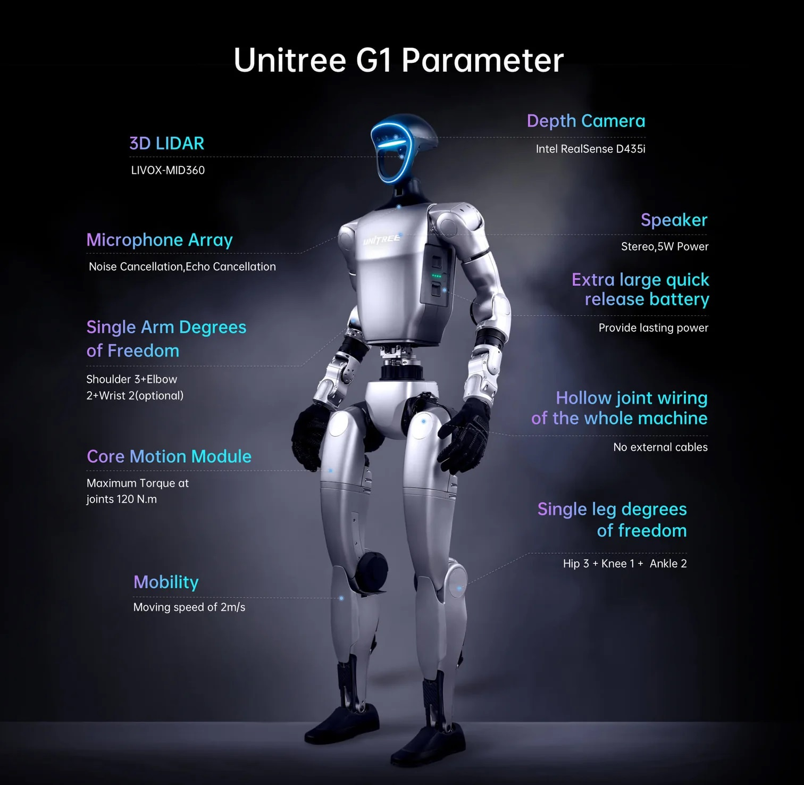

# Unitree G1 (G1no)

Unitree reshaped robotics through mass production using low-cost, in house actuators.

- **Quadrupeds**: XDog $\rightarrow$ A1/Go1 -> Go2
- **Humanoids**: H1 (2023) - 1.8m, 47kg $\rightarrow$ G1 (2024) - 1.2m, 36kg

The G1 is a compact humanoid designed for research in locomotion, manipulation etc.
Its base platform features 23 degrees of freedom (up to 43 if expanded with dexterous hands, e.g. in the Edu package).

It comes with an **Nvidia Jetson Orin SOM** (100-275 TOPS) and uses 9000 mAh batteries for up to 2 hours of operational time.

The Unitree G1 can be controlled in
- *SDK Torque Mode*, bypassing onboard high level controllers to stream joint torques at 1000 Hz, or
- *High Level Motion Mode*, to accept target velocities with Unitree's built-in RL Stack.

## Some more specs

- **Size & weight**: about 1.32m tall when standing and roughly 35kg (with battery). It can also be folded down to around 0.69m x 0.45m x 0.3m, which makes it quite easy to transport compared to bigger humanoids.
- **DoF breakdown (base, 23 DoF)**: 6 per leg, 1 at the waist and 5 per arm. The Edu version adds more waist joints, 2 extra wrist joints per arm and optionally the hands, which is how you get to the higher DoF numbers.
- **Hands**: the Edu version can be equipped with the *Dex3-1* three-finger hands (7 DoF each, with optional tactile sensors) or third party hands like the *Inspire* hands. Without hands it only has simple end effectors, so not really useful for manipulation.
- **Joint torque**: max. knee torque is around 90 Nm for the base version and ~120 Nm for the Edu version. The joints use hollow shafts for internal cabling and have dual encoders.
- **Payload**: each arm can carry roughly 2kg (around 3kg for Edu), so it is more meant for light tabletop manipulation and not heavy lifting.
- **Walking speed**: up to around 2 m/s.
- **Sensors**: the head has an *Intel RealSense D435i* depth camera and a *Livox MID-360* 3D LiDAR. There is also a 4-mic array and a speaker for voice interaction.
- **Connectivity**: WiFi 6 and Bluetooth 5.2. The battery is quick-release, so you can swap it without much hassle.
- **Price**: the base version started at around $16k, which is really cheap for a humanoid. The Edu versions are a lot more expensive though (price on request, depends on configuration).

The following table provides the joint indices, names, and respective joint limits in radians:

|Index|Joint Name|Limit (rad)|Approx. Limit (deg)|
|:---|:---|:---|:---|
|0|L_LEG_HIP_PITCH|-2.5307 ~ 2.8798|-145.0° ~ 165.0°|
|1|L_LEG_HIP_ROLL|-0.5236 ~ 2.9671|-30.0° ~ 170.0°|
|2|L_LEG_HIP_YAW|-2.7576 ~ 2.7576|-158.0° ~ 158.0°|
|3|L_LEG_KNEE|-0.087267 ~ 2.8798|-5.0° ~ 165.0°|
|4|L_LEG_ANKLE_PITCH|-0.87267 ~ 0.5236|-50.0° ~ 30.0°|
|5|L_LEG_ANKLE_ROLL|-0.2618 ~ 0.2618|-15.0° ~ 15.0°|
|6|R_LEG_HIP_PITCH|-2.5307 ~ 2.8798|-145.0° ~ 165.0°|
|7|R_LEG_HIP_ROLL|-2.9671 ~ 0.5236|-170.0° ~ 30.0°|
|8|R_LEG_HIP_YAW|-2.7576 ~ 2.7576|-158.0° ~ 158.0°|
|9|R_LEG_KNEE|-0.087267 ~ 2.8798|-5.0° ~ 165.0°|
|10|R_LEG_ANKLE_PITCH|-0.87267 ~ 0.5236|-50.0° ~ 30.0°|
|11|R_LEG_ANKLE_ROLL|-0.2618 ~ 0.2618|-15.0° ~ 15.0°|
|12|WAIST_YAW|-2.618 ~ 2.618|-150.0° ~ 150.0°|
|13|WAIST_ROLL|-0.52 ~ 0.52|-29.8° ~ 29.8°|
|14|WAIST_PITCH|-0.52 ~ 0.52|-29.8° ~ 29.8°|
|15|L_SHOULDER_PITCH|-3.0892 ~ 2.6704|-177.0° ~ 153.0°|
|16|L_SHOULDER_ROLL|-1.5882 ~ 2.2515|-91.0° ~ 129.0°|
|17|L_SHOULDER_YAW|-2.618 ~ 2.618|-150.0° ~ 150.0°|
|18|L_ELBOW|-1.0472 ~ 2.0944|-60.0° ~ 120.0°|
|19|L_WRIST_ROLL|-1.9722 ~ 1.9722|-113.0° ~ 113.0°|
|20|L_WRIST_PITCH|-1.6144 ~ 1.6144|-92.5° ~ 92.5°|
|21|L_WRIST_YAW|-1.6144 ~ 1.6144|-92.5° ~ 92.5°|
|22|R_SHOULDER_PITCH|-3.0892 ~ 2.6704|-177.0° ~ 153.0°|
|23|R_SHOULDER_ROLL|-2.2515 ~ 1.5882|-129.0° ~ 91.0°|
|24|R_SHOULDER_YAW|-2.618 ~ 2.618|-150.0° ~ 150.0°|
|25|R_ELBOW|-1.0472 ~ 2.0944|-60.0° ~ 120.0°|
|26|R_WRIST_ROLL|-1.9722 ~ 1.9722|-113.0° ~ 113.0°|
|27|R_WRIST_PITCH|-1.6144 ~ 1.6144|-92.5° ~ 92.5°|
|28|R_WRIST_YAW|-1.6144 ~ 1.6144|-92.5° ~ 92.5°|

