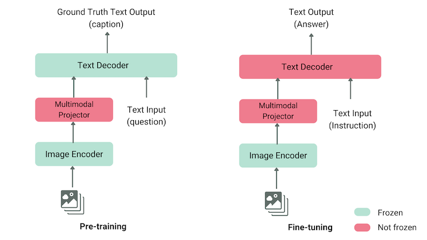

# Vision Language Action Models - VLAs

#### Vision Language Models (VLMs) as Backbones

Vision Language Models (VLMs) are models that can learn simultaneously from **images and text** to tackle many tasks, from visual question answering to image captioning. Large VLMs have good zero-shot capabilities, generalize well and work with lots of image types including web pages and docs. Some even capture spatial image properties such as locatipons and bounding boxes. 

VLMs can be **pretrained** in different ways, e.g. with (expensive) end-to-end training plus language-only instruction fine-tuning. Usually, however, the process involves an **image encoder**, **multimodal projector** and **text decoder**. Initially, only the projector is trained to align image and text and in a a second step the text decoder is fine-tuned on top.

In short, VLMs are the models we use everyday, so the best known ones include GPT-5, Gemini-3, Claude Opus etc., all of which are multimodal by now (i.e. you can upload and interact with media other than just plain text). Interesting open source alternatives include **Qwen** by Alibaba, **Mistral** and **PaliGemma** by Google.

In **Robot Learning**, VLAs are a class of multimodal foundation models that **integrate vision, language and actions**. Given an input image/video and a text instruction, a VLA directly outputs low-level robot actions that can be used to accomplish the task.

VLAs are usually constructed by **co-fine-tuning** a VLM on a large-scale dataset that pairs visual observations and language instructions with robot trajectories. These models essentially replace a VLMs text decoder with an **action decoder** that transforms elements from a latent space (encoded by the vision transformer) into continous output actions.

Usually, VLAs rely on off the shelf VLMs (prior understanding) serving as the perception and reasoning core. In a second stage, they are extended with an action decoder mapping tokens to discrete symbols which are then de-tokenized into continuous robot commands. Output actions are represented in the same way as language tokens, but refer to the degrees of freedom (DoF) of the robot's end effector.

The concept of Vision Langage Action Models was first pioneered by [Google Deepmind's RT-2](../Papers/RT-2%20VLA.pdf), then made open-source through OpenVLA and Octo, and extended into generalized cross-embodiment by [$\Pi_0$](../Papers/π0.7-%20a%20Steerable%20Generalist%20Robotic%20Foundation%20Model%20with%20Emergent%20Capabilities.pdf) and humanoids by Helix and [Groot](../Papers/Gr00t.pdf).

A special design choice of a VLA is the robot action format:

#### Action Tokenization

The most common approach involves **discrete output tokens** (RT-2, OpenVLA). Each motion is generated as an action string, keeping the same output layer as the VLM and making training straightforward. However, this approach slightly limits spatial accuracy and temporal resolution. 

[$\Pi_0$](../Papers/π0.7-%20a%20Steerable%20Generalist%20Robotic%20Foundation%20Model%20with%20Emergent%20Capabilities.pdf) for example, makes use of an alternative approach, outputting **continuous actions** in order to achieve accurate dexterity and high frequency control. **Diffusion Models** start with random noise and gradually clean it into a smooth result, whereas **flow models** draw a direct highway that smoothly slides random noise into the result values. For continuous values, the VLAs head passes its raw numbers straight into one of these smoothers which return continuous mathematical vectors.

> NOTE: VLA models can be organized either as a single end-to-end network (RT-2, OpenVLA, $\Pi_0$) or as a dual-system - one component handling input and another producing output (Groot, Helix).

---

## 1. Gr00t

Gro00t - Generalist Robot 00 Technology - is NVIDIA's family of Vision-Language-Action (VLA) foundation models for humanoid and embodied robots, and has evolved across versions like N1, N1.5, N1.6, N1.7 (lateset, until the release of the anticipated N2).

> The point is not the humanoid demo. A manufacturer should care less about whether a model understands a natural-language instruction in isolation and more about whether that instruction can be grounded in fixtures, tolerances, quality rules, safety interlocks, and human approval paths.

Its key design choice is the **split between high-level reasoning and low-level action generation**. Gr00t N1.7 additionally connects an encoder to a flow-matching action transformer and then frames post-training as the path to domain specialization.

This means that GR00T is not a raw high-frequency motor-torque loop by itself. Instead, the stack uses decoupled control:
- *GR00T (VLA / Policy Layer):* Takes camera images, robot state, and a text prompt (like "move the apple to the plate") and predicts action chunks (for example, a 40-step chunk at 50 Hz = 800 ms) rather than a single step at a time.   
- *Low-Level / Whole-Body Control Layer:* Keeps the robot balanced and translates commanded targets into high-rate actuator commands.

|Research Line|Layer Strenghtened|Manufacturing Interpretation|
|:--|:--|:--|
|Groot N1/N1.7|VLA execution interface|Base policy for turning work instructions into action chunks|
|SOMA/BONES/Kimodo/MotionBricks|Motion interface and reference generation|Supply chain for turning human motion into robot embodiment references|
|SONIC|Whole body motion prior|Lower-level stability for walking, posture and bimanual work|
|GRAIL|Synthettic loco-manipulation demonstration|Task-level humanoid demo candidates from 3D assets and video priors|
|VIRAL/Doorman|Pixel-to-action sim-to-real|Validation pattern for transferring visual policies to real robots|
|PLD|Self-improving VLA|Loop for safely absorbing failure-region data in to the policy|
